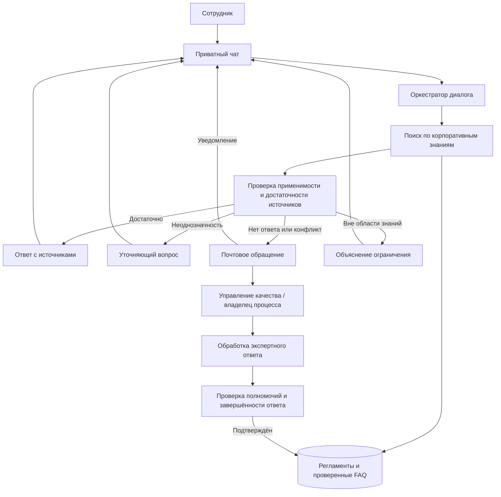

# Предлагаемое решение: ИИ-агент поиска ответов по корпоративным документам

> Предложения команды по полному контуру. Архитектура, критерии приёмки, план демонстрации и приоритеты не предписаны заказчиком. Это цель, а не описание стенда.
>
> Постановка задачи — в `TASK_STATEMENT.md`. Что уже запущено — в `specs/specs/knowledge.md`, `specs/specs/chat.md` и `specs/solution/`.

## Статус

Уже есть: чат по четырём регламентам и глоссарию, короткий ответ со ссылкой на пункт, уточнение дирекции не больше трёх раз, отдельные блоки по разным регламентам, показ противоречия внутри одного регламента, прямой отказ без выдуманного правила, каталог документов, диалоги в Postgres.

Из этого предложения ещё нет: письма в управление качества, сохранения экспертного ответа и ответа им на следующий похожий вопрос (AC-10…AC-12), аналитики пробелов, Confluence и DION. Дыры лексического поиска — в `search.md`.

## 1. Целевая архитектура

Один возможный вариант полного контура. RAG, конкретные компоненты и формат хранения остаются решением команды. Почта и экспертная база на стенде не подключены.

### 1.1. Компоненты

| Компонент | Назначение |
| --- | --- |
| Document ingestion | Извлечение структуры регламентов, заголовков, пунктов, таблиц, подразделений и ссылок. |
| Knowledge storage | Хранение документов, фрагментов, метаданных и отдельных подтверждённых FAQ. |
| Retrieval | Поиск по ключевым словам и/или семантике; фильтрация по подразделению и применимости, повторное ранжирование при необходимости. |
| Dialogue orchestrator | Контекст диалога, уточнения, маршрутизация между ответом, оговоркой, эскалацией и отказом. |
| Grounded answer generator | Формирование ответа только из доступных подтверждённых материалов. |
| Evidence validation | Проверка достаточности, соответствия ответа источникам, полноты ссылок и потенциальных противоречий. |
| Email integration | Отправка запроса, сопоставление входящей переписки с обращением, обработка ответов экспертов. |
| Knowledge feedback | Извлечение и сохранение проверенных разъяснений; защита от пополнения базы неподтверждёнными сообщениями. |
| Analytics | Метрики качества, скорости, уточнений, эскалаций и пробелов базы знаний. |

### 1.2. Рекомендуемые данные для хранения

- `Document`: идентификатор, название, подразделение, исходный адрес или локальный путь, версия/статус при наличии, дата индексации.
- `DocumentSection`: документ, путь заголовков, номер пункта (если он существует), текст, ссылки на связанные документы.
- `Conversation`: пользователь, история сообщений, текущий контекст, число уточнений.
- `Answer`: текст, источники, тип результата, оговорки.
- `ExpertRequest`: внутренний ID, вопрос, контекст, состояние, идентификаторы почтовой переписки. ID полезен технически, но не обязателен для отображения сотруднику.
- `ExpertKnowledge`: нормализованный вопрос, экспертный ответ, происхождение, автор/роль при наличии, время получения, область применимости, связанные документы, состояние проверки и актуальности.

Рекомендуется не смешивать нормативные документы и экспертные разъяснения без явного указания их происхождения. При изменении связанного регламента полезно инициировать проверку ранее сохранённых разъяснений. Это проектное предложение, а не согласованное правило приоритета источников.

Для демонстрации использовать настраиваемые почтовые адреса и доверенные тестовые аккаунты. В production необходимо проверять полномочия отправителя, привязку ответа к обращению, защищаться от неподтверждённых записей и не воспринимать текст документов или писем как системные инструкции модели.

## 2. Оценка качества и предлагаемые критерии приёмки

На встрече заказчик не установил числовых порогов точности, эскалаций, стоимости и задержки. Эталонный набор вопросов с ответами для участников не планировался. Управление качества выступает экспертом при оценке корректности ответов. Правила оценки жюри следует уточнить у организаторов.

### 2.1. Предлагаемый тестовый набор

Подготовить вопросы по каждому из четырёх исходных регламентов и междокументные сценарии. Для каждого теста фиксировать вопрос, ожидаемый тип поведения, подтверждённые факты, применимое подразделение, источники, допустимые уточнения и недопустимые утверждения. Для сценария эксперта отдельно проверять состояние до и после добавления подтверждённого ответа.

| ID | Сценарий проверки | Предлагаемый критерий приёмки |
| --- | --- | --- |
| AC-01 | Прямой вопрос | Все существенные утверждения подтверждены конкретными источниками; нет вымышленных фактов. |
| AC-02 | Несколько источников | Все необходимые условия отражены; источники соответствуют частям ответа. |
| AC-03 | Не указана дирекция | Агент не выбирает произвольный регламент, запрашивает контекст. |
| AC-04 | Контекст уточнён | Ответ соответствует выбранной дирекции и сохраняет контекст предыдущего сообщения. |
| AC-05 | Комплексный проект | Правила дирекций отражены раздельно, без усреднения. |
| AC-06 | Уточнение не помогло | После максимум трёх итераций предложен следующий шаг с качеством. |
| AC-07 | Частичный ответ / конфликт | Показана подтверждённая информация и оговорки; неразрешённый конфликт передан эксперту. |
| AC-08 | Отсутствует связанный документ | Агент не выдумывает его содержание и ссылки. |
| AC-09 | Вопрос вне области знаний | Агент не использует общие знания как корпоративное правило. |
| AC-10 | Нет ответа по регламентам | Реальное письмо доставлено в тестовый ящик качества, пользователь включён в переписку. |
| AC-11 | Эксперт ответил | Подтверждённый окончательный ответ сохранён как доступный для поиска источник. |
| AC-12 | Повторный вопрос | Агент отвечает с использованием экспертного источника без повторного обращения. |

### 2.2. Предлагаемые метрики

| Метрика | Смысл |
| --- | --- |
| Answer correctness | Доля корректных ответов по экспертной оценке. |
| Groundedness | Доля существенных утверждений, подтверждённых указанными источниками. |
| Citation accuracy | Доля ссылок на действительно подтверждающие положения. |
| Completeness | Полнота условий, исключений и требуемых действий. |
| Clarification accuracy | Доля случаев, когда агент корректно распознал необходимость уточнения и получил нужный контекст. |
| Escalation recall / precision | Доля вопросов, требующих эксперта, которые действительно переданы, и доля обоснованных обращений среди всех переданных. |
| Hallucination rate | Доля ответов с неподтверждёнными утверждениями. |
| Expert knowledge reuse | Корректность повторного ответа после добавления экспертного знания. |
| Latency | Время до первого полезного вывода и до полного ответа, например p50/p95. |
| Knowledge gaps | Частые вопросы без ответа, проблемные разделы, востребованные документы. |

Не оптимизировать снижение эскалаций за счёт точности. Лайки пользователей полезны как дополнительный сигнал, но не заменяют проверку фактической правильности.

Источники: 00:18:44, 00:30:53, 01:02:25–01:06:04, 01:07:35–01:10:36.

## 3. План демонстрации

1. **Прямой ответ:** задать конкретный вопрос по одному регламенту, показать краткий ответ и переход к подтверждающему пункту.
2. **Неоднозначность:** задать вопрос о сроках расчёта без указания дирекции. Агент уточняет дирекцию, затем отвечает со ссылкой; можно дополнительно показать вариант комплексного проекта.
3. **Замкнутый цикл экспертного знания:** задать релевантный вопрос, ответ на который отсутствует в корпусе. Показать корректное признание ограничения, отправку письма в тестовый ящик, экспертный ответ на письмо, его сохранение и новый ответ на аналогичный вопрос со ссылкой на сохранённое разъяснение.

Дополнительно при наличии времени показать вопрос вне предметной области, конфликт положений и аналитику пробелов базы знаний.

## 4. Главные приоритеты реализации

- Уже в продукте: достоверный ответ с источниками; уточнение контекста; обработка конфликтов и неполных источников (следующий шаг называется, письмо не уходит).
- Дальше по этому предложению: реальная почтовая эскалация; повторное использование подтверждённого экспертного ответа.
- Затем: именованные учётные записи вместо cookie посетителя; правка и удаление диалога; аналитика пробелов базы; интеграция с Confluence и DION; жизненный цикл экспертных разъяснений.

**Главный принцип:** агент должен помогать сотруднику дойти до корректного ответа, не подменяя корпоративные правила собственными предположениями.
