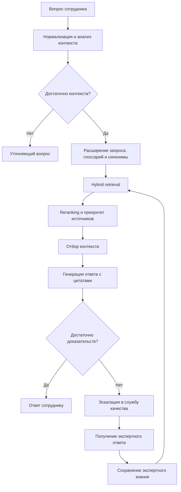

# ИИ Кузница — ИИ-агент поиска ответов по корпоративным документам

> Summary разъяснений кейсодателя в чате задачи от 26.11.2026. Подтверждённые требования отделены от рекомендаций по реализации. При расхождениях с более ранними ответами FAQ ниже учтено последнее разъяснение в чате (17:26).

## 1. Цель и контекст

Создать AI-ассистента, отвечающего на вопросы сотрудников по корпоративным регламентам. У заказчика уже есть локально развёрнутая LLM, однако качество текущего решения его не устраивает. Ожидается альтернативный подход с разумным балансом качества и стоимости.

Текущее хранилище регламентов — Atlassian Confluence (внутренняя Wiki без дополнительных add-ons). Ограничений на совместимость с существующими вычислительными мощностями заказчика нет.

## 2. Данные и тестирование

- Предоставлены четыре обезличенных регламента.
- Готовый датасет вопросов и правильных ответов не предоставляется; тестовые вопросы нужно формировать самостоятельно, в том числе с помощью ИИ.
- Вопросы не должны быть только прямыми переформулировками требований регламентов.
- Основные паттерны реальных запросов: абстрактные вопросы без достаточного контекста и вопросы с альтернативной терминологией, сокращениями, синонимами или английскими названиями.
- Предоставлен корпоративный глоссарий. Его разрешено хранить в открытом репозитории. Он предназначен для понимания запросов, а не для ограничения формулировок пользователей.

Пример: `руководитель проекта` → `РП` → `project manager`.

## 3. Требования к моделям и инфраструктуре

| Параметр | Требование / разъяснение |
| --- | --- |
| LLM | Open Weights; возможность локальной эксплуатации и дообучения по условиям лицензии |
| Лицензия | Apache 2.0 или другая подходящая открытая лицензия |
| Embeddings | Модель должна допускать локальную эксплуатацию в рамках лицензии |
| GPU | Базовая предпосылка — 128 GB VRAM |
| Квантизация | Веса LLM должны укладываться в 128 GB VRAM при квантизации не хуже Q4 |
| Cloud API | Разрешены на хакатоне, включая демонстрацию, если соответствующие модели можно эксплуатировать локально |
| OpenAI | Закрытые модели и embeddings OpenAI не проходят критерий возможности локальной эксплуатации |
| Более мощное железо | Требуется обоснование и обсуждение с организаторами |
| Документация | При сдаче указать используемые модели, включая embeddings, и предоставить ссылки на карточки моделей с лицензиями (например, Hugging Face) |

Пример допустимого подхода — облачный API подходящей модели Qwen с возможностью последующего локального развёртывания. Необходимо проверять конкретную модель и её лицензию, а не только семейство моделей.

**Важно:** разъяснение от 17:26 отменяет более строгое толкование раннего FAQ о необходимости полностью изолированной демонстрации. Физически локальная обработка на хакатоне не обязательна; возможность локальной эксплуатации остаётся обязательной.

## 4. Экономика решения

При сдаче необходимо заполнить блок экономического расчёта на платформе.

- Основной ориентир для сравнения — стоимость обработки запроса на основе потребления токенов по официальным тарифам провайдера модели.
- Расчёт нужен даже при предполагаемом локальном развёртывании: локальный inference тоже требует ресурсов и не является бесплатным.
- Дополнительно можно указать стоимость аренды подходящего сервера в РФ в ЦОД, соответствующем требованиям по персональным данным (152-ФЗ).
- Качество результата в соотношении со стоимостью — один из критериев оценки.

Рекомендуется собирать статистику по input/output tokens, количеству вызовов моделей, стоимости embeddings/reranking (где применимо), latency и суммарной стоимости запроса.

## 5. Приоритет источников и эскалация

Если ответ эксперта службы качества противоречит действующему регламенту, **приоритет имеет ответ службы качества**: регламент может находиться в процессе актуализации.

```text
Ответ эксперта службы качества > опубликованный регламент
```

Для демонстрации сценария эскалации вопросов в службу качества и получения экспертных ответов достаточно тестового почтового ящика.

## 6. Демонстрация

- Допускается доступный по URL демонстрационный стенд с предоставленными обезличенными регламентами, в том числе без авторизации при запрете индексации поисковыми системами.
- В обсуждении стенда через HTTPS-туннель организаторы предложили хранить документы отдельно от проекта, например в отдельном Docker Compose volume.
- Глоссарий разрешено публиковать в открытом репозитории. Отдельного разрешения на публикацию самих файлов регламентов в репозитории в чате нет.
- Жюри может выполнять запросы на стенде для проверки работоспособности. При использовании платных API необходимо оставить бюджет на несколько запросов; точное количество пока не определено.

## 7. Оценка

Формальные критерии оценки указаны в приложении 1 положения конкурса. Детальная методика проверки качества ответов (закрытый набор вопросов, LLM-as-a-judge, способ ранжирования) в обсуждении не раскрыта.

## 8. Рекомендации по реализации (не обязательные требования)

Предлагаемая архитектура — локально разворачиваемый RAG-агент с возможностью работы через облачные API на этапе конкурса и заменой inference endpoint при переходе в контур заказчика.



Рекомендуемые компоненты:

- Confluence connector и расширяемый document ingestion pipeline.
- Hybrid retrieval: полнотекстовый и векторный поиск.
- Нормализация терминов, обработка сокращений и синонимов, уточнение неоднозначных запросов.
- Reranking, выбор релевантных фрагментов и учёт приоритетов источников.
- Ответы с проверяемыми цитатами и ссылками на источники.
- Обработка недостаточности информации и противоречий.
- Email workflow для эскалации и сохранения экспертных ответов с provenance.
- Сменные провайдеры LLM и embeddings для облачного и локального inference.
- Метрики качества, потребления токенов, latency и стоимости.

### Evaluation harness

Рекомендуется собрать собственный набор из 100–300 синтетических и вручную проверенных вопросов, включая:

- прямые и перефразированные вопросы;
- сокращения, синонимы и смешанную русско-английскую терминологию;
- вопросы с недостаточным контекстом;
- вопросы, требующие нескольких фрагментов или документов;
- вопросы без ответа в базе знаний;
- противоречия между регламентом и экспертным ответом;
- проверку эскалации.

Оценивать корректность ответа, обоснованность источниками, качество retrieval, корректность отказа/эскалации, latency и стоимость запроса.

## 9. Чек-лист команды

- [ ] Скачать и изучить предоставленные регламенты.
- [ ] Добавить корпоративный глоссарий.
- [ ] Выбрать LLM, embeddings и при необходимости reranker с подходящими лицензиями и возможностью локального запуска.
- [ ] Проверить требования к VRAM и квантизации; оценить runtime overhead отдельно от размера весов.
- [ ] Реализовать ingestion, retrieval и ответы с источниками.
- [ ] Реализовать приоритет экспертных ответов и email-эскалацию.
- [ ] Подготовить evaluation dataset и сравнить варианты pipeline.
- [ ] Организовать учёт токенов и экономический расчёт.
- [ ] Подготовить доступный стенд, отключить индексацию и предусмотреть бюджет запросов жюри.
- [ ] Описать локальное развёртывание и приложить ссылки на лицензии моделей.
- [ ] Сверить решение с формальными критериями конкурса.

## 10. Открытые вопросы

- Точная методика проверки качества и ранжирования команд.
- Точное количество запросов жюри.
- Дополнительные ограничения на публикацию исходных файлов регламентов, если потребуется хранить их в публичном репозитории.

## 11. Материалы

- [Датасет и документация — Google Drive](https://drive.google.com/drive/folders/1toFmwPD6c6XcCQzBcbfJPskJGzMh23tY)
- [FAQ задачи](https://docs.google.com/document/d/14sXfRni_XYZRNJphBcUrexzvJq1c7LNXTG6Dfde-B6Q/edit?tab=t.0#heading=h.z9b63cf0mi9e)
- [Положение конкурса — приложение 1](https://иикузница.рф/regulations/v1.html)
- Запись брифинга опубликована в чате задачи; прямая ссылка отсутствует в предоставленном тексте. Транскрипции и скачиваемого файла записи не предусмотрено.

---

Источник: предоставленная переписка чата задачи за 26.11.2026. Содержимое внешних ссылок отдельно не проверялось. Архитектурные рекомендации, evaluation harness и чек-лист являются предложениями для команды, а не дополнительными официальными требованиями.
