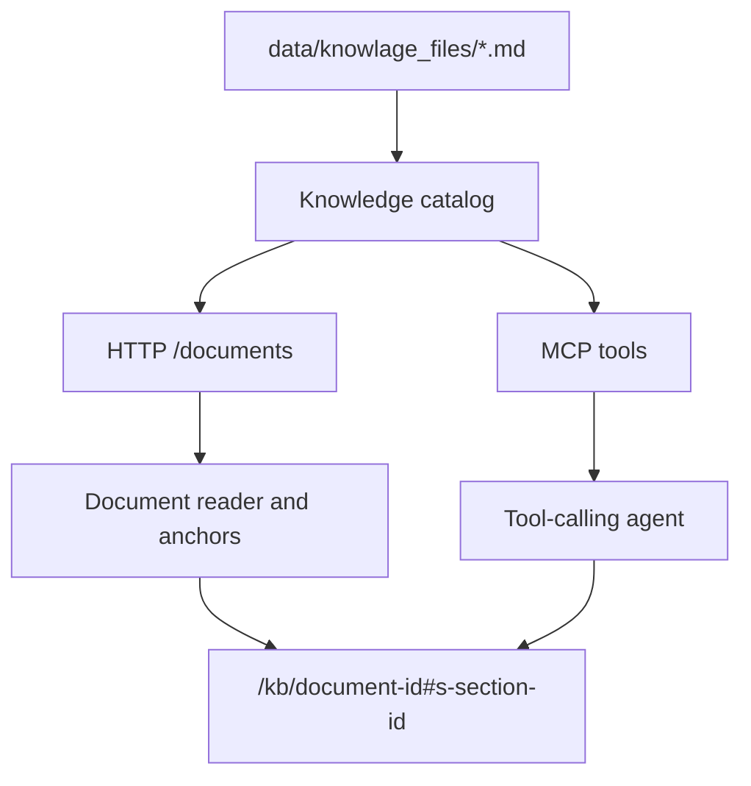

# Knowledge base: pages for people, tools for the agent

Draft. One catalog of `data/knowlage_files` serves the React UI and the LLM agent. The UI reads it over HTTP. The agent reads the same objects through MCP tools. A citation and a page anchor use the same id.

## What already exists

`back/chat/chat/knowledge.py` loads the folder once at startup (`KNOWLEDGE_DIR`, otherwise `data/knowlage_files`).

- `glossary.md` is the glossary. It is not a regulation.
- Every other `*.md` file is a regulation. The `#` line is the title. Each `##` block is a section. Text before the first `##` is a section named `Введение`.
- `Section` today is `document`, `heading`, `body`, `source_name`. There is no stable id.
- Chat does not browse this catalog. `render_context` ranks sections with BM25 and pastes the winners into the system message (`specs/specs/002_local_context.md`).
- The UI is one chat screen (`front/src/App.jsx`). Vite proxies `/api` to FastAPI.

The files are already shaped for a reader: numbered `##` headings (`## 1. Запрос на инициацию проекта`, and so on), about 16–34 sections per regulation.

## One catalog, two doors

Parsing, ids, and search stay in the knowledge module. HTTP and MCP are thin adapters. The agent does not fetch the UI, and the UI does not speak MCP.



In-process chat may call the catalog functions directly. MCP is the contract when the model decides which document or section to open. The tool list and the HTTP routes are the same operations.

## Ids and anchors

Add two ids when a file is parsed. They do not change if the heading wording is edited, as long as the filename and the section number stay.

| Id | Rule | Example |
| --- | --- | --- |
| `document_id` | File stem | `project-activity-ib` |
| `section_id` | Leading number on the `##` line | `1` for `## 1. Запрос на инициацию проекта` |
| preamble | No number | `intro` for `Введение` |
| glossary | Fixed document | `document_id = glossary` |

A heading without a leading number gets a slug of the heading text. Duplicate `section_id` inside one file fails load.

Anchor in the page: `s-{section_id}` (`s-1`, `s-intro`). The prefix keeps the id off bare numbers.

Reader URL, through the Vite app:

```text
/kb/project-activity-ib#s-1
```

That URL is the citation. The agent, the chat bubble, and the table of contents all point at it.

## HTTP API

Read-only routes on the existing FastAPI app. The browser calls them as `/api/...`, and Vite strips `/api` as it does for sessions.

`GET /documents`

```json
{
  "documents": [
    {
      "id": "project-activity-ib",
      "title": "Проектная деятельность Дирекции ИБ",
      "source_name": "project-activity-ib.md",
      "sections": [
        { "id": "1", "heading": "1. Запрос на инициацию проекта", "anchor": "s-1" }
      ]
    }
  ]
}
```

List payload has headings only. Bodies stay off this route so the sidebar stays small.

`GET /documents/{document_id}`

```json
{
  "id": "project-activity-ib",
  "title": "Проектная деятельность Дирекции ИБ",
  "source_name": "project-activity-ib.md",
  "sections": [
    {
      "id": "1",
      "anchor": "s-1",
      "heading": "1. Запрос на инициацию проекта",
      "body_markdown": "**1.1.** После согласования..."
    }
  ]
}
```

`GET /documents/{document_id}/sections/{section_id}` returns one section in the same shape. Unknown id is `404`.

`GET /glossary` returns the glossary as one document. Each `ABBR = ...` line is a section with `section_id` equal to the abbreviation (`РП`, `SLA`), anchor `s-РП`. The intro lines above the first term are `intro`.

Bodies are the original markdown of that block, not HTML. The UI renders markdown and sets the anchor itself. GitHub-style heading slugs are not used: the API id is the only anchor.

Search for the UI can wait. The first reader is browse-by-outline. `GET /documents/search?q=` can later return the same hits as MCP `search_sections` (`document_id`, `section_id`, `heading`, `score`, short snippet) so a hit opens `/kb/{document_id}#s-{section_id}`.

## Frontend

A navbar switches between two screens: **Chat** and **Documents**. Chat answers link into Documents at the section the answer used. The bubble does not paste the regulation text again.

```text
[ Chat ] [ Documents ]
----------------------------------------------
Documents
  regulations          section in the open file
  - Дирекция ИБ        1. Запрос на инициацию    id=s-1
  - Пресейл ИБ         2. Назначение РП          id=s-2
  - Техническая дир.
  - ДБРЦТ
  - Глоссарий

Chat answer
  ... см. раздел
  [1. Запрос на инициацию проекта](/kb/project-activity-ib#s-1)
  click -> Documents, that file, scrolled to s-1
```

Navbar:

| Item | Route | Screen |
| --- | --- | --- |
| Chat | `/` | Current chat. |
| Documents | `/kb` | Catalog. Opens the regulation list. |

The active item follows the route. A chat link to `/kb/...#s-...` switches the navbar to Documents and opens that anchor. Back to Chat returns to the same session.

Documents navigation has two levels.

1. **Across documents.** The catalog lists the four regulations and the glossary (`GET /documents` plus the glossary). Choosing one opens `/kb/{document_id}`.
2. **Inside the open document.** A section list is built from the outline. Each item is `<a href={"#" + anchor}>` (`#s-1`, `#s-2`, …). The reader loads `GET /documents/{id}` once, renders each `body_markdown`, and sets `id={anchor}` on the section heading. Changing the hash scrolls to that heading and highlights the matching item in the section list. It does not refetch.

Empty hash opens the document at the top with no section selected. Unknown `documentId` stays on the catalog and shows an error. A hash that matches no section stays at the top.

Chat links are part of the answer, not a separate source footer. The model cites with a markdown link whose path is the reader URL:

```text
[1. Запрос на инициацию проекта](/kb/project-activity-ib#s-1)
```

The visible text is the section heading. The path is `path` from the catalog (`/kb/{document_id}#{anchor}`). The bubble renderer turns that into an in-app link: Documents opens, the file loads, the page scrolls to the anchor. Only paths that start with `/kb/` become links. Any other URL in the answer stays plain text.

The same link works for the glossary (`/kb/glossary#s-РП`), so a mention of an abbreviation can open that term.

The system message on both the preselected-context path and the tool path tells the model to include one such link for every section it used. Tool results already carry `path`. The preselected bundle in `render_context` includes the same `path` next to each heading, so an answer can link to the right anchor without a tool call.

## MCP for the agent

MCP is how the model works with document and section text. Tools return the catalog ids so the model can cite a URL the UI already understands.

Expose the server on the same process, Streamable HTTP at `/mcp`. A local stdio entry is the same tools for Cursor. Tool handlers call the catalog; they do not read files themselves.

| Tool | Returns | When the model uses it |
| --- | --- | --- |
| `list_documents` | id, title, section count. No bodies. | "Which regulations exist?" |
| `get_outline` | `document_id`, headings, section ids, anchors. No bodies. | Pick a section before reading it. |
| `get_section` | One section: ids, heading, `body_markdown`, reader path. | Read or quote a section. |
| `get_document` | Full document markdown. | Only when the question needs the whole file. Prefer `get_section`. |
| `search_sections` | BM25 hits: document id, section id, heading, score, snippet, reader path. Same ranking as `select_sections`. | Normal question. |
| `get_glossary` | Full glossary text, or one abbreviation when `term` is set. | Expand `РП`, `ТКП`, and the other short forms. |

`search_sections` and `get_section` are the default path. Regulations are large; dumping a file into the prompt is what the current 8-section cap already avoids. `get_document` exists so a question about the shape of a regulation still has an answer.

Each section payload includes the path the UI uses:

```json
{
  "document_id": "project-activity-ib",
  "document_title": "Проектная деятельность Дирекции ИБ",
  "section_id": "1",
  "heading": "1. Запрос на инициацию проекта",
  "anchor": "s-1",
  "path": "/kb/project-activity-ib#s-1",
  "body_markdown": "..."
}
```

System instructions for the tool loop:

- Answer in Russian from tool results only.
- Search, then open the sections you cite. Do not cite a section you have not read.
- When several regulations match and the question does not say which, ask which one.
- End with markdown links to `path`. The visible text is the document title and the section heading.
- If search returns nothing, say so.

The current `complete()` path can stay for a turn that only needs the preselected BM25 bundle. The tool loop replaces that bundle when the model must open a specific section, follow a citation, or read past the eight-section cap. Both paths use the same `Section` objects, so a preselected fragment and an MCP `get_section` result are the same text and the same anchor.

## Code

| Piece | Place |
| --- | --- |
| Parse, ids, anchors, BM25 | `back/chat/chat/knowledge.py` — extend `Section` with `document_id`, `section_id`, `anchor` |
| HTTP | `back/chat/chat/main.py` or `back/chat/chat/kb_http.py` |
| MCP tools | `back/chat/chat/kb_mcp.py`, mounted at `/mcp` |
| Reader and citation links | `front/src`, routes above, markdown render for section bodies and for `/kb/` links in bubbles |
| Files | `data/knowlage_files/` |

`select_sections` keeps working. It gains ids in the rendered context (`path` next to the heading) so an answer can link to the reader even on the non-tool path.

## Out of this slice

- Upload, Confluence, S3, accounts. The folder remains the source.
- Editing a document from the UI or from a tool.
- A second search implementation for MCP. `search_sections` calls `select_sections`.
- HTML stored in the API. Markdown in, anchors applied in the UI.
- Auth on `/documents` or `/mcp`. Same trust level as the chat API today.
