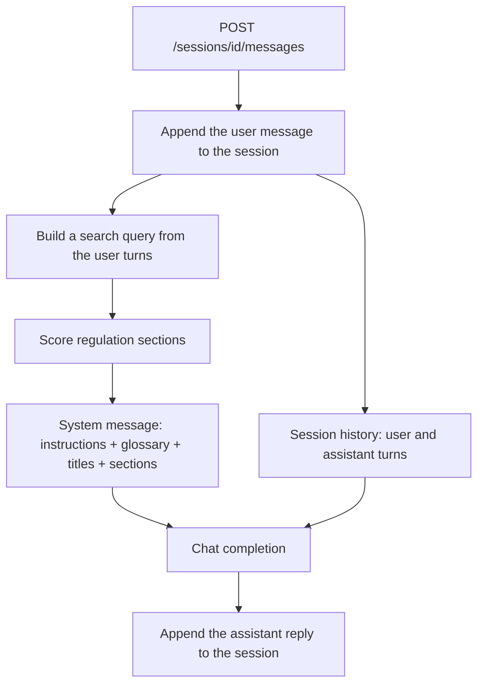

# Local regulation context

The chat answers from files in `data/knowlage_files`. Each model call gets a system message built for the current question: standing instructions, the whole glossary, the list of regulation titles, and the matching sections.

## Flow

Startup loads the files once (`load_knowledge` in the app lifespan). The first completion loads them if startup did not. `KNOWLEDGE_DIR` overrides the folder. Otherwise the loader walks parent directories for `data/knowlage_files`.

`glossary.md` is the glossary. Every other `*.md` file is a regulation, read in filename order. A missing glossary or an empty regulation set fails startup.

## System message

`complete` sends one system message, then the session history unchanged.

The system message is:

1. Instructions: answer in Russian from the glossary and the attached sections only, treat a glossary abbreviation and its full forms as the same term, cite the document title and section number, ask a clarifying question when the sections come from different regulations or the facts are not enough, and say when the attached text has no answer.
2. The full glossary.
3. The regulation titles, from the `#` heading of each file.
4. The selected sections, each as `# document title`, `## section heading`, and the section body.

If nothing matches, the message says that no fragments were found.

## How a section is chosen

Regulations are split on `##` headings. The `#` heading is the document title. Text before the first `##` becomes a section named `Введение`.

The search query is the latest user message. If that message is shorter than 160 characters and an earlier user message exists, the previous user message is prepended. That keeps a short follow-up on the same topic.

Glossary lines of the form `abbreviation = phrase; phrase` expand the query. A matching abbreviation adds the other forms in its group. Prefixes `то же:`, `должность:`, `документ:`, and `вместе с` are stripped. `ПО`, `ТП`, `КП`, `ЗП`, `КИ`, and `СБ` match only in that case. Other glossary forms match regardless of case.

Sections are ranked with BM25 (`k1 = 1.5`, `b = 0.75`) over tokens. Russian words are lightly stemmed. The section heading is indexed three times, the document title once, and the body once. Stopwords are dropped.

A section is kept when its score is at least 40% of the best score. At most 8 sections are kept. Their bodies stay within 18 000 characters; the best section is kept even if it is longer, and later sections stop at the limit.

## Limits

Selection is lexical. A question that paraphrases a rule without the regulation's words can miss the section that contains the answer. Embeddings can replace the ranking inside the same system message.

## Code

| Piece | Module |
| --- | --- |
| Session and completion call | `back/chat/chat/main.py` |
| Instructions and model request | `back/chat/chat/llm.py` |
| Load, rank, render | `back/chat/chat/knowledge.py` |
| Source files | `data/knowlage_files/` |
