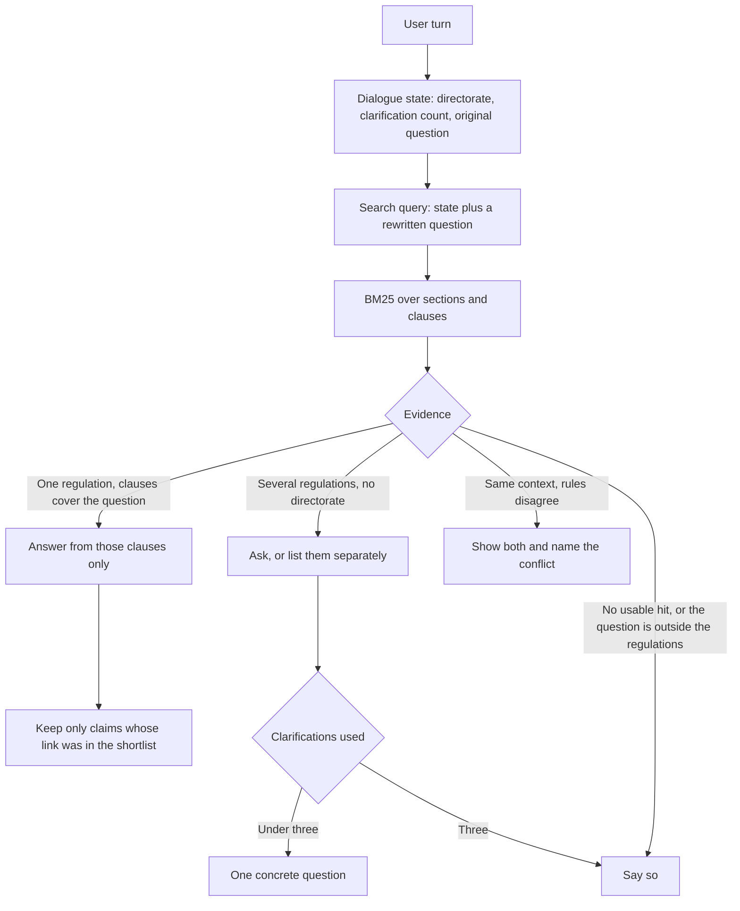

# Better reasoning

The proposal in `specs/ideas/PROPOSED_SOLUTION.md` wants a grounded answer, a clarifying question, or an explicit limit. The chat in `back/chat/chat` still does one completion over a BM25 shortlist. This slice improves that decision. Mail, saved expert answers, and analytics stay out of it.

## What the code does

`POST /sessions/{id}/messages` appends the user turn and calls `complete` once (`llm.py`). `render_context` (`knowledge.py`) builds the system message: standing instructions, the whole glossary, the regulation titles, and up to 8 sections. `002_local_context.md` describes that selection. Since then, each selected section also carries a `/kb/{document}#s-{section}` link, and the same catalog is exposed over HTTP and MCP. `complete` does not call those tools.

The model is told to answer only from the attached text, to ask when the sections come from different regulations or the facts are not enough, and to say when the text has no answer. Nothing in the server checks that it did so. `temperature` is `0.5`.

Retrieval is lexical. The query is the latest user message, plus the previous user message when the latest one is shorter than 160 characters. Glossary aliases expand the query. A section stays when its score is at least 40% of the best score, the body budget is 18 000 characters, and the count is at most 8.

## Where that misses the proposal

| Proposal | Now | What goes wrong |
| --- | --- | --- |
| AC-01, AC-02. Every material claim cites the clause that supports it. | The link is the `##` section, for example `s-2`. Clauses such as `**2.6.**` stay inside the body. | A right section can still hide the wrong rule. The server does not check that the link was in the shortlist. |
| AC-03, AC-05. An unnamed directorate is a question or separate answers, not one blended procedure. | The instruction says to ask. The prompt still pastes full sections from every regulation that scored. | The model can average Дирекция ИБ and ДБРЦТ into one workflow. |
| AC-04. A follow-up keeps the chosen context. | Only a short latest message pulls in the previous user message. There is no stored directorate. | A longer second question drops the first. The assistant's own clarification is not part of the query. |
| AC-06. Stop after three clarifications. | No count. | The chat can keep asking. |
| AC-07. A real conflict is shown and not resolved by guesswork. Different directorates are not a conflict. | Both cases are the same instruction: ask which regulation. | A true conflict inside one regulation is not separated from "which department?" |
| AC-08, AC-09. Missing text and questions outside the regulations are refusals. | Empty search says so. Any positive best score can still attach sections at 40% of that score. | A paraphrase that barely matches still receives eight loosely related sections, which the model may treat as evidence. |
| A question that does not reuse the regulation's words. | BM25 plus glossary aliases. | "Оживить отклонённую карточку" or "администратор вместо PM" can miss `**2.4.**` and `**2.6.**` even though the glossary maps PM to РП. |

Test questions for these cases are already in `data/tests_data/`. Nothing runs them against `complete`.

## Target turn

The mail step from the proposal is not in this diagram. When the turn ends in "say so", the reply can name управление качества as the next step without sending a letter.

## Changes

Do them in this order. Each one is visible on the existing scenarios.

1. **Reject a weak shortlist.** Keep the 40% rule, and add a floor: if the best section shares too little with the query, attach nothing. Pass the document ids of the shortlist into the instructions. When those ids differ and the dialogue has no directorate, the instruction is to ask or to answer regulation by regulation, and not to merge the steps.

2. **Cite the clause.** Split section bodies on `**N.N.**` markers. Give each clause the parent section path plus the clause number. The answer link stays `/kb/{document}#s-{section}`; the visible text includes the clause, for example `2.6`. Index the clause text so a deadline or an exception can outrank the rest of its section.

3. **Remember the dialogue.** On each turn record the directorate when the user or the shortlist makes it plain, the original question, and how many clarifying questions the assistant has already asked. Build the search query from that state. After three clarifications, the next reply states the limit instead of asking again.

4. **Rewrite the query before BM25.** One short model call turns the user wording into terms and aliases that occur in the regulations, then the current ranker runs. Embeddings can replace that ranker later; they are not required to test this.

5. **Check the reply.** Lower `temperature`. Drop or regenerate a factual sentence whose `/kb/` link was not in the shortlist. A reply that used several regulations must keep those regulations in separate parts.

6. **Score the scenarios.** For each item in `data/tests_data/`, record whether the reply answered, asked, or refused; whether every `/kb/` link was in the shortlist; and whether the expected clause number appears. Run that before and after the steps above.

## Left for a later slice

Sending mail, storing an expert answer, and serving it on the next similar question are AC-10, AC-11, and AC-12. They need a store and a mailbox. This plan only makes the chat stop inventing a rule when that store is empty.
