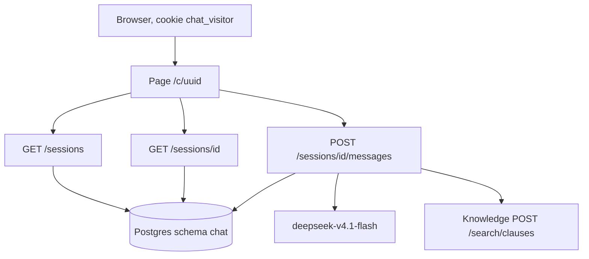

# Chat

`back/chat` stores dialogues in Postgres schema `chat` (same database `rag` as the catalog) and is the only process that calls the model. A restart does not drop a dialogue. The page keeps the id in the path: `/c/{uuid}`.



The dialogue id in the URL is `chat.sessions.id`. The cookie names the owner. They are different values.

| Who opens `/c/{uuid}` | Transcript | Composer |
| --- | --- | --- |
| The visitor who created it | yes | on |
| Any other visitor | yes | off |

The other visitor's list does not gain this dialogue. Reading it does not change `owner_id`.

## Visitor

The first request without a valid `chat_visitor` cookie inserts `chat.visitors` and sets the cookie. The cookie value is `secrets.token_urlsafe(32)`. The table stores `sha256` of that string as hex in `token_hash`. The raw token is not stored. A cookie whose hash matches no row is treated as absent.

Attributes: `HttpOnly`, `SameSite=Lax`, `Path=/`, `Max-Age` 400 days. `Secure` is set when the request is HTTPS. The browser talks to the Vite origin (or the stand origin); that origin proxies `/api` to chat, so the cookie goes out with each `/api` call.

Clearing the cookie starts a new visitor. Old rows stay with the old visitor. This browser can still open an old `/c/{uuid}` and read it. The composer stays off.

## Schema

Every id is a UUID version 7. Postgres 18 fills it with `uuidv7()`. Alembic revisions live in `chat.alembic_version`, separate from the knowledge service.

```sql
create schema if not exists chat;

create table chat.visitors (
    id uuid primary key default uuidv7(),
    token_hash text not null unique,
    created_at timestamptz not null default now()
);

create table chat.sessions (
    id uuid primary key default uuidv7(),
    owner_id uuid not null references chat.visitors (id) on delete cascade,
    created_at timestamptz not null default now(),
    updated_at timestamptz not null default now(),
    title text check (title is null or char_length(title) between 1 and 80)
);

create table chat.messages (
    id uuid primary key default uuidv7(),
    session_id uuid not null references chat.sessions (id) on delete cascade,
    position integer not null check (position >= 0),
    role text not null check (role in ('user', 'assistant')),
    content text not null check (char_length(content) > 0),
    created_at timestamptz not null default now(),
    unique (session_id, position)
);

create table chat.turn_logs (
    id uuid primary key default uuidv7(),
    session_id uuid not null references chat.sessions (id) on delete cascade,
    position integer not null check (position >= 0),
    user_message_id uuid not null references chat.messages (id) on delete cascade,
    assistant_message_id uuid references chat.messages (id) on delete cascade,
    created_at timestamptz not null default now(),
    format_version integer not null check (format_version >= 1),
    payload jsonb not null,
    unique (session_id, position)
);
```

`sessions.title` comes from the first user message: one line, trimmed, cut at 80 characters. Until then the list shows «Новый диалог». `updated_at` moves on every committed message. The list is that visitor's rows, `updated_at` descending.

`messages` are the transcript. The next model call sends them in `position` order and ignores `turn_logs`. System text is rebuilt every turn.

`turn_logs` is one row per exchange. `format_version` 1 is the payload written now: model, temperature, `search_text`, `rewritten_query`, `directorate_id`, `clarification_count`, `retried`, `dropped_links`, `draft_reply`, `error`, and `hits` (ids and score, no clause body). A failed turn leaves `assistant_message_id` null and puts the API error in `payload.error`. The user message stays.

## Access

| Call | Owner | Other visitor |
| --- | --- | --- |
| `GET /sessions` | that visitor's rows | that visitor's own rows |
| `POST /sessions` | inserts a row they own | inserts a row they own |
| `GET /sessions/{id}` | transcript, `writable: true` | transcript, `writable: false` |
| `POST /sessions/{id}/messages` | appends | 403, `Этот диалог только для чтения` |
| `GET /sessions/{id}/turn-logs` | the debug log | 403 |

A path that is not a UUID, or an id with no row, is 404 `Сессия не найдена`. `GET /sessions/{id}` returns `{id, title, writable, messages}`.

`POST /sessions/{id}/messages` does not hold a row lock while the model runs.

1. Lock the session, insert the user message, set the title on the first one, commit.
2. `answer_turn`.
3. On success, insert the assistant message and a `turn_logs` row, commit. On failure, insert a `turn_logs` row with `error` and return 502. The user message stays.

## One turn

`answer_turn` in `back/chat/chat/llm.py`:

1. `read_dialogue` takes the original question, the latest user message, a directorate when the transcript names exactly one of ИБ, ДБРЦТ, or Техническая дирекция, and the count of assistant messages that contain `?`. The cap is 3.
2. `rewrite_query` asks the model (`temperature = 0`) for one line of regulation terms and appends it to the search text. A failed rewrite searches the dialogue text alone.
3. `POST /search/clauses` on the knowledge service. A known directorate limits the corpus to that directorate's documents. See `specs/specs/knowledge.md`.
4. The system message is the standing instructions, the glossary, the regulation titles, and the clauses, each with `/kb/{document}#s-{section}`. The model is `deepseek-v4.1-flash`, `temperature = 0.2`.
5. If the reply cites a section outside the shortlist, or mixes several regulations into one block, the same request goes to the model once more. Links outside the shortlist are then removed. Glossary links are allowed. An empty reply becomes the fixed line that there is no confirmed answer and the next step is управление качества. No letter is sent.

`/` lists this visitor's dialogues. «Новый диалог» calls `POST /sessions` and moves to `/c/{uuid}`. F5 on that path loads `GET /sessions/{id}` again. `writable: false` leaves the composer off. Links to `/kb/…` open the reader.

## Code

| Piece | Place |
| --- | --- |
| Schema | `back/chat/alembic`, revision `0001_chat` |
| Rows and cookie | `back/chat/chat/sessions.py` |
| Routes | `back/chat/chat/main.py` |
| Turn | `back/chat/chat/llm.py`, `back/chat/chat/reasoning.py` |
| Page | `front/src/App.jsx` route `/c/{uuid}`, `front/src/Chat.jsx` |
